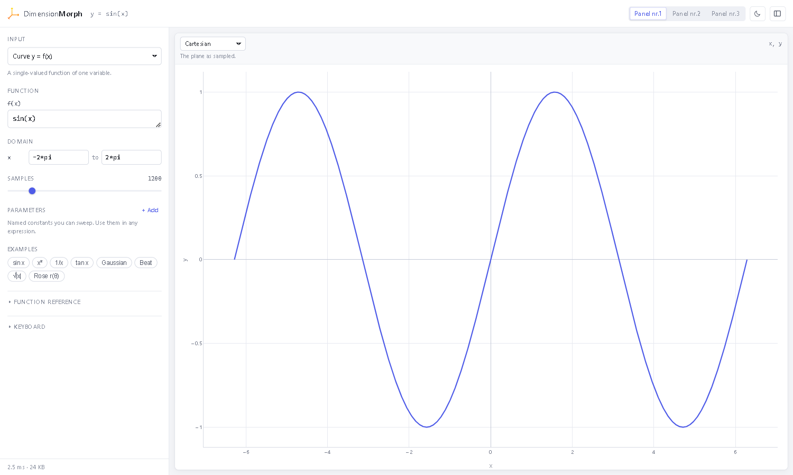

# DimensionMorph

Take a function, then look at it in a different coordinate system.

The same numbers can describe very different pictures depending on how you read
them. `cos(5x)` is a wave in Cartesian coordinates and a five-petalled rose when
`x` is read as an angle and `y` as a radius. DimensionMorph keeps three
independent panels, each holding its own coordinate system; the picker in the
top bar chooses which one is on screen.



## Running it

```bash
pip install -r requirements.txt
python app.py
```

Then open <http://127.0.0.1:5000>.

Configuration is read from the environment: `DM_HOST`, `DM_PORT`, `DM_DEBUG`
(`0` to switch off the reloader), `DM_STATIC_MAX_AGE`. For a real deployment,
serve the factory with a WSGI server instead:

```bash
waitress-serve --port 5000 "dimensionmorph:create_app()"
```

## Inputs

| Input | Variables | Produces |
| --- | --- | --- |
| Curve `y = f(x)` | `x` | a plane curve |
| Parametric curve `(x(t), y(t))` | `t` | a plane curve |
| Surface `z = f(x, y)` | `x`, `y` | a surface |
| Parametric surface `(x, y, z)(u, v)` | `u`, `v` | a surface |
| Complex map `w = f(z)` | `z` (also `x`, `y`) | a complex field |

Range bounds accept expressions, so `-2*pi` and `4*pi` are valid bounds.

## Coordinate systems

**For plane curves:** Cartesian, polar (θ–r plane), polar (circular),
log-polar, triangular (three axes 120° apart), hyperbolic (Minkowski rapidity
and interval), elliptic, parabolic.

**For surfaces:** Cartesian, spherical, cylindrical, log-spherical, wrapped on
a sphere, wrapped on a cylinder, wrapped on a torus, triangular projection.

**For complex maps:** domain colouring, conformal grid, modulus surface, phase
surface, real-part surface.

Each of the three panels picks its own system from this list, independently of
the others. Switching panels is instant unless the input changed meanwhile, in
which case that panel is redrawn as it comes into view.

The wrapped views *reinterpret* the sampled numbers — "wrapped on a sphere"
reads `x` as azimuth, `y` as polar angle and `z` as radius, then puts the
result back into space. Each panel states its own reading underneath its name.

## Parameters

Add a named constant with **+ Add**, then use it in any expression. Dragging its
slider redraws live. Names are ordinary identifiers; `x`, `y`, `z`, `t`, `u`,
`v` and `w` are reserved for coordinates.

## Sharing

The URL carries the full state — input, expressions, ranges, parameters, views
and which panel is open — so copying the address bar reproduces exactly what
you see.
Theme is stored per browser rather than in the link.

## Keyboard

| Key | Action |
| --- | --- |
| `Ctrl`+`Enter` | redraw now |
| `Enter` in an expression | redraw now |
| `1` `2` `3` | show panel nr.1, 2 or 3 |
| `D` | toggle theme |
| `\` | show or hide the controls |

## Expressions

Ordinary Python arithmetic (`+ - * / // % **`) over NumPy arrays, plus the
functions listed in the sidebar's reference panel. Series work too:

```python
sum(sin(i*x)/i for i in range(1, 12))
prod(1 - x**2/(i*pi)**2 for i in range(1, 8))
```

Expressions are checked against an AST allow-list before they are compiled.
Attribute access, subscripting, imports, lambdas, comprehension over anything
but `range`, and any unknown name are refused, so the usual `().__class__`
sandbox escapes do not parse. Compiled code is cached, which is what makes
dragging a slider cheap.

## Layout

```txt
app.py                  entry point
dimensionmorph/
  expr.py               AST-checked expression evaluator
  sources.py            inputs: sampling and the form catalogue
  transforms.py         coordinate transforms, pure NumPy
  figures.py            Plotly figure assembly and theming
  routes.py             /api/catalog and /api/plot
static/css/app.css      design tokens, layout, components
static/js/app.js        form building, request handling, rendering
templates/index.html    page shell
tests/                  pytest suite
```

Sources and transforms are registries. Adding an entry to `SOURCES` or to one
of the transform tuples makes it appear in the UI automatically — the form and
the view menus are built from `/api/catalog`, not hard-coded in the page.

Plotly is only used in the browser. The server builds plain dictionaries, so
`flask` and `numpy` are the whole dependency list.

## Tests

```bash
python -m pytest tests -q
```

The suite renders every coordinate system for every input, checks the
invertible transforms against their closed forms, verifies that responses are
strict JSON (`NaN` would be rejected by `JSON.parse`), and asserts that the
sandbox refuses a list of known escape attempts.
